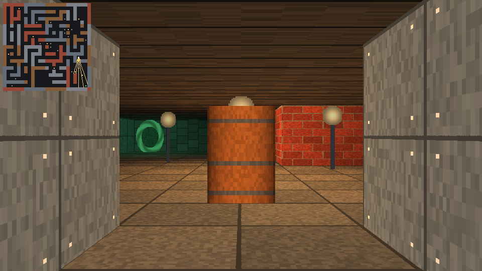

# raycast-rs

raycast-rs is a Wolfenstein-style 3D software raycaster written from scratch in Rust, with **no crates, no OpenGL and no wasm-bindgen**. Every pixel is computed on the CPU into a framebuffer. It has:

- textured walls found by DDA grid traversal
- floor and ceiling casting
- depth-sorted billboard sprites against a z-buffer
- coloured, flickering point lights with distance fog
- wall sliding collision
- a seeded maze generator and a minimap

The same crate compiles natively (tests, benchmarks, PPM snapshots) and to a **68 KB WebAssembly module** that you play in the browser.



*960×540, rendered by `cargo run --release --bin snapshot`. A lamp sprite is depth-sorted behind the barrel, and the exit portal tints the wall green. All textures are generated procedurally at startup.*

```bash
node tools/build-web.mjs && node tools/serve.mjs     # play at http://127.0.0.1:8070  (needs: rustup target add wasm32-unknown-unknown)
cargo test --release                                  # 15 tests
cargo run --release --bin bench                       # native render benchmark
cargo run --release --bin snapshot -- out.ppm 960 540 7
```

Controls: `W` `S` move, `A` `D` strafe, `Q` `E` or the arrow keys turn, click the view for mouse look, `Shift` runs. Toggles: `M` minimap, `L` lighting, `F` fog, `T` torch, `X` textures. `N` makes a new maze. The goal is to find the green portal.

## The maths

### 1. Camera

The player has a position **p**, a direction **d** = (cos θ, sin θ) and a camera plane **c** perpendicular to **d** with length tan(FOV/2) = 0.66 (about a 66° field of view). Screen column x maps to camera space `k = 2x/w − 1 ∈ [−1, 1]`, and its ray is

```
r(k) = d + c·k
```

### 2. DDA: which cell does the ray hit?

Along **p** + t·**r**, the t-distance between two vertical grid lines is |1/rₓ|, and between two horizontal lines is |1/r_y|. DDA tracks the t of the *next* crossing on each axis and always steps the nearer one (Amanatides & Woo 1987):

```
δx = |1/rx|,  δy = |1/ry|
sx = (rx<0 ? p.x − ⌊p.x⌋ : ⌊p.x⌋+1 − p.x) · δx          // t to the first x-line
loop: if sx < sy { sx += δx; cell.x += sign(rx); side = 0 }
      else       { sy += δy; cell.y += sign(ry); side = 1 }
      until map[cell] is solid
t_hit = side==0 ? sx − δx : sy − δy                       // undo the last step
```

This visits every cell the ray passes through, in order, with constant work per cell. There are no epsilon steps, and rays can't slip through corners. Cells outside the map count as solid, so every ray terminates.

### 3. Perpendicular distance (no fish-eye)

Because **r** = **d** + **c**k and **c** ⊥ **d**, the parameter t at the hit equals the hit's distance *along the view direction*, not along the ray. Using t directly makes a flat wall project at constant height, so there is no fish-eye bulge and no `cos` correction is needed. `perpendicular_distance_removes_fisheye` casts 40 columns at a flat wall and checks that every one reports the same distance, 6.5, within 1e-4.

### 4. Wall slice and texture coordinate

```
lineHeight = h / t                       // the camera is half a wall above the floor
y ∈ [(h − lineHeight)/2, (h + lineHeight)/2]
wallX = frac(side==0 ? p.y + t·ry : p.x + t·rx)    // where along the face we hit
texX  = wallX · 64  (mirrored on faces seen from the "back" so text reads correctly)
texY  steps by 64/lineHeight per screen row
```

### 5. Floor and ceiling casting

For screen row y below the horizon, the floor point seen there lies at

```
rowDist = (h/2) / (y − h/2)
```

That follows from similar triangles with the camera at height h/2. Across that row, the world position moves linearly from the leftmost ray (k = −1) to the rightmost (k = +1). Each pixel therefore costs **one add** per coordinate:

```
floor(x=0) = p + rowDist·(d − c),   step = rowDist·2c / w
```

The ceiling row is the mirror image `h − y − 1`, which uses the same world coordinates.

### 6. Sprites

Each sprite is transformed into camera space with the inverse of the 2×2 matrix [**c** **d**]:

```
invDet = 1 / (cx·dy − dx·cy)
tx     = invDet · ( dy·sx − dx·sy)        // horizontal offset
depth  = invDet · (−cy·sx + cx·sy)        // distance in front of the camera
screenX = (w/2)·(1 + tx/depth),  size = h/depth
```

Sprites are sorted far to near. Each screen column (stripe) of a sprite is drawn only where `depth < zbuffer[column]`, the wall distance from step 3. Transparent texels (alpha 0) are skipped. `sprites_occluded_by_walls` checks a barrel in the open (drawn) and the same barrel behind a wall (not drawn).

### 7. Lighting and fog

```
light(q) = ambient + Σᵢ colorᵢ · 1.1 · (1 − |q−Lᵢ|²/rᵢ²)²      for |q−Lᵢ| < rᵢ
pixel    = texel ⊙ light · fog + fogColor · (1 − fog),   fog = e^(−0.085·dist)
```

The falloff reaches exactly zero at radius r, so lights outside their radius can be culled without changing the image. The 12 nearest lights are kept each frame: the player's torch plus lamps and the exit portal. Lamps flicker with two summed sines at a per-lamp phase.
- **Walls** are lit once per column, at the hit point.
- **Floors and ceilings** are lit every 4th pixel along a row; the value is held for the pixels in between, because floor lighting changes slowly.
- **y-faces** are darkened by 22% as a cheap directional cue.
- **Lamps and the portal are emissive.**

### 8. Collision

The player is a box of half-width 0.22. A move is split into an x move and a y move, and each is accepted only if all four corners stay in empty cells and clear of pillar and barrel props. Dropping only the blocked axis gives **wall sliding**. Fast frames are split into sub-steps of at most 0.1 cells, so the player can't tunnel through a corner. One fuzz test runs 5,000 random frames and checks that the player never ends up inside a wall. Another checks that diagonal movement into a wall slides along it.

### 9. Maze

The maze is a perfect maze from iterative depth-first backtracking on a (2n+1)² grid. Then:
- about 8% of single walls between two corridors are knocked out to create loops;
- a few 3×3 rooms are cleared;
- wall textures are assigned by 6×6 regions;
- lamps, barrels and pillars are scattered with a seeded xorshift RNG;
- the exit goes in the far corner.

A test checks with BFS that the exit is reachable for several seeds.

## Benchmarks

Native: `cargo run --release --bin bench` (Windows 11, x86-64, single thread, 300 frames while walking and turning through the maze).

| configuration | ms/frame | fps | DDA steps/frame |
|---|---:|---:|---:|
| 320×180, all features | 1.11 | 900 | 549 |
| 640×360, all features | 4.27 | 234 | 1,099 |
| 960×540, all features | 9.63 | 104 | 1,649 |
| 1920×1080, all features | 37.57 | 27 | 3,298 |
| 640×360, no lighting | 3.81 | 262 | 1,099 |
| 640×360, no fog | 4.10 | 244 | 1,099 |
| 640×360, flat colours (no textures) | 2.80 | 357 | 1,099 |
| 640×360, no minimap | 4.25 | 235 | 1,099 |

**WebAssembly in the browser** (headless Edge, `web/?bench`, 200 frames, same scene): **2.18 ms** at 320×180, **10.28 ms** at 640×360, **18.46 ms** at 960×540. That is about 2× slower than native. The likely causes are that this build doesn't use wasm SIMD and that wasm memory accesses are bounds-checked; I haven't profiled it. The interactive page at 640×360 ran at 60 fps (the vsync cap), spending 7.8 ms of each frame in wasm.

**Where the time goes.** The DDA is cheap: about 1,100 steps per frame at 640×360. The cost is per-pixel work:
- **Texture fetches are the largest share:** turning textures off saves about 35%.
- **Per-pixel floating-point lighting and fog cost about 10%.**
- **Floor and ceiling casting is about half the screen,** so it is the place to optimize next: 8-bit fixed-point shading, or row-coherent light caching.

## Limitations

- **Lights have no shadows.** They are not occluded, so a lamp lights the floor on the other side of a wall within its radius. Small radii hide this in the maze, but a proper fix needs a per-light visibility test (casting rays to lights) or a lightmap baked on the grid.
- **Grid-only geometry.** No doors, height changes or slopes, and walls are exactly one cell high. These are the classic raycaster constraints.
- **Single-threaded and no SIMD.** Columns are independent, so the wall pass parallelizes trivially, but wasm threads need cross-origin isolation headers.
- **There is no native window.** The repo has no windowing crate, by design. Native builds render to PPM and to the benchmark; you play in the browser.
- **Mouse look needs Pointer Lock;** without it, turn with the keys.

## Layout

```
src/ray.rs     DDA traversal (Hit: perpendicular distance, side, cell, wallX)
src/engine.rs  player, collision, lighting, floor/ceiling, walls + z-buffer, sprites, minimap
src/map.rs     ASCII map parser, maze generator, sprites, lights, xorshift RNG
src/tex.rs     procedural 64×64 textures: brick, stone, wood, metal, floor, ceiling, 4 sprites
src/lib.rs     extern "C" API for wasm (rc_init, rc_frame, rc_fb, rc_stat, rc_option) + PPM writer
src/bin/       bench.rs · snapshot.rs (searches the maze for a viewpoint with props and lights)
web/           index.html · main.js (host: input, ImageData blit) · raycast.wasm (built)
tests/         15 tests: exact DDA distances, diagonal and corner hits, fuzzed hit points on cell
               faces, fish-eye invariance, maze connectivity, collision fuzz, sliding, light falloff,
               deterministic full-frame render, odd resolutions, sprite occlusion, win condition, C ABI
```

## License

MIT
